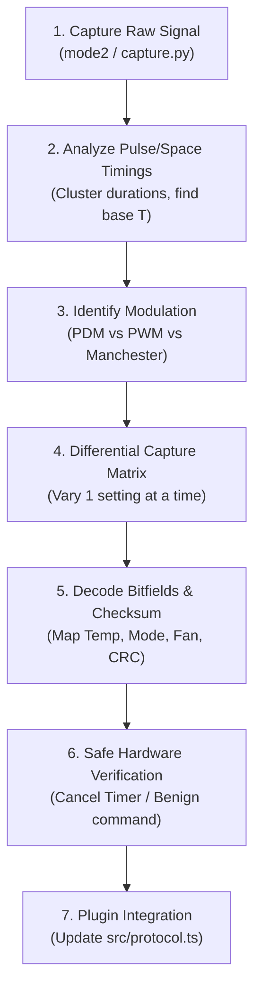

# IR Protocol Reverse Engineering & Capture Skill

This skill guides an agent or engineer through capturing, analyzing, decoding, and integrating unsupported or customized infrared remote control protocols (such as AEHA, NEC, Sony, or custom vendor formats) on Linux.

---

## ⚠️ Critical Safety Directives

> [!CAUTION]
> **NEVER SEND POWER ON / OFF TOGGLE COMMANDS IN RAPID TEST LOOPS.**
> The physical appliance is within line-of-sight of the transmitter LED. Repeated power cycling can damage the compressor or irritate users.
>
> **Safe Testing Rules**:
> 1. Always verify bitfield logic using unit tests and differential binary comparisons first.
> 2. When testing hardware transmission to `/dev/lirc0`, use benign non-power commands such as **Cancel Timer**, **Set Flap Position**, or **Fan Speed Adjust**.
> 3. Verify transmitter hardware without running the compressor by testing target temperatures close to ambient or testing when the unit is already safely off.

---

## Hardware Architecture

| Interface | Device Node | Typical GPIO (Raspberry Pi) | Tool / Method |
| :--- | :--- | :--- | :--- |
| **IR Receiver** (RX) | `/dev/lirc1` | GPIO 17 (VS1838B / TSOP4838) | `mode2 -d /dev/lirc1` or `[tools/capture.py](tools/capture.py)` |
| **IR Transmitter** (TX) | `/dev/lirc0` | GPIO 22 (`gpio-ir-tx`) | Direct `ioctl` (`0x40046913`, `0x40046915`) + `write()` |

---

## Workflow: Step-by-Step Protocol Reverse Engineering



---

### Step 1: Capture Raw Signal

Run the receiver tool on `/dev/lirc1` while pointing the original remote at the receiver diode:

```bash
# Using the built-in capture utility
python3 tools/capture.py

# Or directly with mode2
mode2 -d /dev/lirc1
```

A captured frame looks like a sequence of alternating pulse and space durations in microseconds:
```text
pulse 3320
space 1710
pulse 440
space 410
pulse 445
space 1290
...
pulse 440
```

---

### Step 2: Determine Base Unit Timing ($T$) and Modulation

Analyze the pulse and space durations to identify the modulation type:

1. **Pulse Distance Modulation (PDM)** *(Most ACs, including AEHA, Sanyo, Panasonic)*:
   - **Pulse width is fixed**: e.g., $\approx 440\ \mu\text{s}$ ($1T$).
   - **Space width encodes the bit**:
     - Short space $\approx 400\ \mu\text{s}$ ($1T$) = Bit `0`
     - Long space $\approx 1250\text{–}1300\ \mu\text{s}$ ($3T$) = Bit `1`
   - **Header**: Pulse $\approx 8T$ ($3300\ \mu\text{s}$), Space $\approx 4T$ ($1700\ \mu\text{s}$).

2. **Pulse Width Modulation (PWM)** *(e.g. Sony SIRC)*:
   - **Space width is fixed**: e.g., $\approx 600\ \mu\text{s}$ ($1T$).
   - **Pulse width encodes the bit**:
     - Short pulse $\approx 1T$ = Bit `0`
     - Long pulse $\approx 2T$ or $3T$ = Bit `1`

3. **Bi-Phase / Manchester** *(e.g. Philips RC-5 / RC-6)*:
   - Fixed bit interval; transition occurs in the middle of each bit period.

---

### Step 3: Differential Capture Strategy

Air conditioner remotes transmit their **entire state** in a single large frame (typically 128 to 300+ bits). 

To isolate what each bit means, capture pairs of signals where **only one parameter changes**:

| Test Pair | Fixed Settings | Varied Parameter | What It Reveals |
| :--- | :--- | :--- | :--- |
| **Temp Sweep** | Cool, Auto Fan, Non-Swing | 24°C vs 25°C vs 26°C | Temperature bitfield & offset |
| **Fan Sweep** | Cool, 24°C, Non-Swing | Auto vs Low vs Med vs High | Fan speed bitfield |
| **Mode Sweep** | 24°C, Auto Fan, Non-Swing | Cool vs Heat vs Auto vs Dry | Mode bitfield |
| **Flap Sweep** | Cool, 24°C, Auto Fan | Pos 1 vs Pos 2 vs Swing | Louver / Flap bitfield |
| **Power State**| Cool, 24°C, Auto Fan | ON vs OFF vs Cancel Timer | Power & action flags |

Use [diff_frames.py](scripts/diff_frames.py) (`python3 .agents/skills/capture-ir-protocol/scripts/diff_frames.py`) to highlight exactly which bits changed.

---

### Step 4: Reverse-Engineering Bitfields and Endianness

1. **Endianness**:
   - Japanese ACs (AEHA standard) use **LSB-first** (Least Significant Bit transmitted first for each byte).
   - If Byte 0 is transmitted as bits `0 1 0 0 0 0 0 0`, its LSB-first integer value is `0b00000010` (`0x02`), not `0x40`.
2. **Checksum / CRC Algorithms**:
   Most AC protocols end with a 1-byte checksum. Check these common formulas:
   - **Sum of all previous bytes**: `Byte[N-1] = sum(Byte[0..N-2]) & 0xFF`
   - **Sum with offset**: `Byte[N-1] = (sum(Byte[0..N-2]) + Offset) & 0xFF`
   - **XOR sum**: `Byte[N-1] = Byte[0] ^ Byte[1] ^ ... ^ Byte[N-2]`
   - **Nibble sum**: Sum upper and lower nibbles of previous bytes modulo 16.

See [aeha_reference.md](references/aeha_reference.md) for known vendor signatures.

---

### Step 5: Native Kernel LIRC Transmission

Synthesize the timing durations into uint32 microsecond values and write directly to `/dev/lirc0`:

```python
import os, fcntl, struct

LIRC_SET_SEND_CARRIER = 0x40046913
LIRC_SET_SEND_DUTY_CYCLE = 0x40046915

def transmit(durations, carrier=38000, duty=50):
    payload = struct.pack(f"<{len(durations)}I", *durations)
    fd = os.open("/dev/lirc0", os.O_RDWR)
    try:
        fcntl.ioctl(fd, LIRC_SET_SEND_CARRIER, struct.pack("I", carrier))
        fcntl.ioctl(fd, LIRC_SET_SEND_DUTY_CYCLE, struct.pack("I", duty))
        os.write(fd, payload)
    finally:
        os.close(fd)
```

In TypeScript/Node.js, use the `ioctl` package directly on `/dev/lirc0` as demonstrated in [src/protocol.ts](src/protocol.ts).

---

### Step 6: Verification & Test Suite

1. Add matching test vectors in [test/protocol.test.js](test/protocol.test.js).
2. Run `npm test` to ensure parity across generators without hardware risk.
